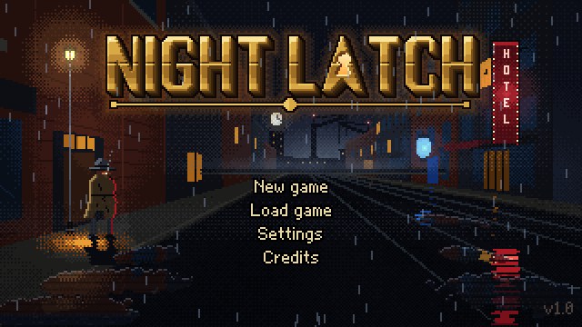
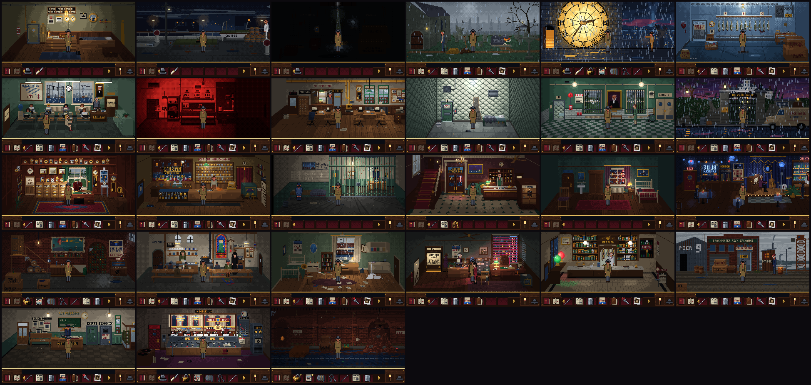
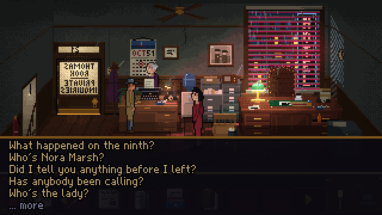
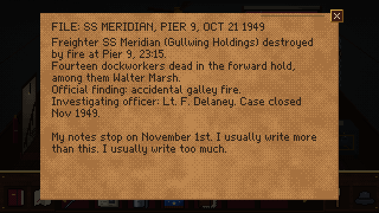
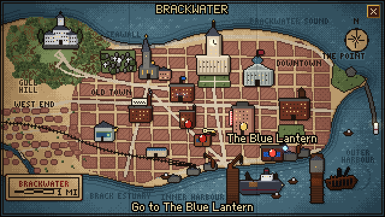
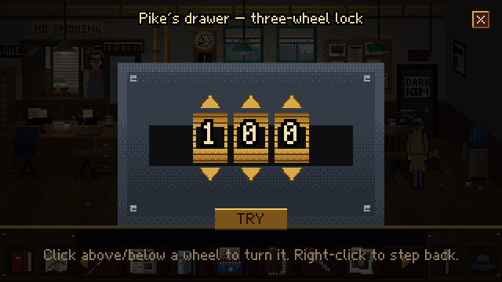
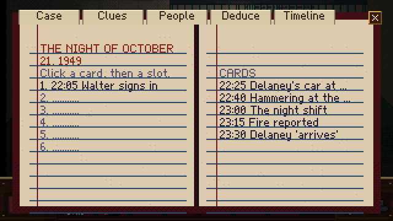
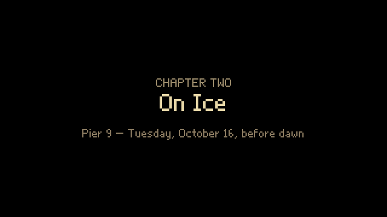

# NIGHT LATCH — A Brackwater Mystery

A noir point-and-click detective adventure in eight chapters, in the tradition of the early-90s
LucasArts adventures. Brackwater, a rain-soaked harbour city, October 1951. Private investigator
**Thomas Rook** keeps waking up in locked rooms with days of his life missing. Every escape leads
deeper into the disappearance of a stenographer named **Nora Marsh**, and into what was done to
Rook's own mind two years ago.





| | |
|---|---|
|  |  |
|  |  |
|  |  |

* 8 chapters, each opening in a different locked room: a hotel room, a fish cold store, a
  darkroom, a padded cell, a police holding cell, a smugglers' cellar, a ship's hold and a radio
  booth. The locked rooms, the disappearances and Rook's memory loss share one explanation,
  revealed on the air in the finale. Nothing supernatural, no dream ending.
* 27 hand-built rooms, 14 places on the city map, 27 characters, 51 items, 86 clues,
  deductions and a timeline reconstruction in the notebook, two combination locks, a radio patch
  bay, and branching dialogue (161 choices) with evidence presentation.
* Notebook (clues, people, deductions, timeline), escalating context hints, autosave at every
  milestone plus six manual save slots, settings for music, sound, text speed, pixel-perfect
  scaling and hints.
* All art (320×180, painted pixel by pixel by the Python pipeline in `art/`), all music,
  ambience and sound effects (synthesized by `audio/`) are original and generated from source
  code in this repository. Expect about two hours for a first playthrough.

## Requirements

* **Node.js 18 or newer** (developed with Node 22) and npm.
* A current desktop browser (Chrome, Edge, Firefox or Safari). The game needs WebGL or Canvas
  and Web Audio.
* Only to regenerate the assets: Python 3.10+ with `numpy` and `Pillow` (art), plus `ffmpeg`
  (audio). The generated assets are committed, so you don't need these to play or build.

## Play without installing anything

`npm run build:portable` writes `release/NightLatch.zip`. Unzip it and double-click
`index.html`: the game runs offline in any current browser, with no server and no install.
Every asset is embedded in `assets-data.js`, because browsers won't load files from a page
opened from disk. The browser test suite passes against the unzipped folder opened via
`file://` as well (5 cases, 62 checks, including the full playthrough).

## Install, run and build

```bash
cd nightlatch
npm install          # dependencies (Phaser, Vite, TypeScript, Playwright, tsx)
npm run dev          # development server with hot reload: http://localhost:5173
npm run build        # type-check and build the static game into dist/
npm run preview      # serve dist/ at http://localhost:4173
```

`dist/` is a fully static site: copy it to any web server, or serve it locally with
`npm run preview`, `npx serve dist` or `python3 -m http.server -d dist`. It must be served over
HTTP, because browsers won't load the game's assets from a `file://` page.

## How to play

| Input | Action |
|---|---|
| Left-click on the floor | walk |
| Left-click on a thing or person | use it, open it, take it, talk |
| Right-click on a thing or person | look at it |
| Click an inventory item, then a thing/person | use the item on it (right-click to put it back) |
| Click an item, then another item | combine them |
| Right-click an inventory item | examine it |
| `N` / notebook button | notebook: clues, people, deductions (link two clues), timeline |
| `M` / map button | city map (from any street door) |
| `H` / lamp button | a hint for the current objective; press again for a stronger one |
| `Esc` / hat button | pause menu: save, load, settings, quit |
| `Tab` or `Space` | show every hotspot in the room |
| `F` | fullscreen |

The game autosaves at every chapter opening and major milestone. **Continue** on the title
screen resumes the most recent save.

## Testing

```bash
npm test                 # engine unit tests (Vitest)
npm run validate         # static check: every reference, hotspot, point, sprite and sound resolves
npm run playtest         # 2,000 seeded automated playthrough simulations (about 15 s)
npm run playtest:sweep   # six such campaigns, 12,000 runs (about 90 s) -> docs/TEST_REPORT.md
npm run build && npm run e2e   # Playwright browser tests -> docs/BROWSER_TEST_REPORT.md
```

* **`validate`** (`tools/validate.ts`) cross-checks the content against the art, audio and
  walkthrough contracts. It also regenerates the puzzle dependency graph in
  [`docs/PUZZLE_GRAPH.md`](docs/PUZZLE_GRAPH.md).
* **`playtest`** (`tools/playtest.ts`) runs thousands of deterministic simulated players through
  the real game logic. It covers the critical path in random valid orders, wrong items and
  combinations, repeated dialogue, out-of-order attempts, save/load into fresh games, rapid travel
  and long chaotic sessions, with softlock detection afterwards. Every run is reproducible:
  `npx tsx tools/playtest.ts --replay <id>`.
* **`e2e`** (`tests/e2e/`) drives the production build in Chromium with real mouse clicks and key
  presses. It covers the title and menus, inventory, notebook, hints, save/load, settings, every
  room (with a frame-rate check) and it plays **the entire game from New game to the ending using
  only mouse input**: hotspots, characters, inventory, dialogue choices, evidence, map pins,
  lock wheels, the patch bay and the notebook's deductions and timeline.
  `npx tsx tests/e2e/tour.ts` saves extra screenshots of speech, menus, documents, the map,
  close-ups and chapter cards for human review.

The simulations and browser runs are automated tests, not human playtests. The reports say
exactly what ran: [`docs/TEST_REPORT.md`](docs/TEST_REPORT.md) and
[`docs/BROWSER_TEST_REPORT.md`](docs/BROWSER_TEST_REPORT.md).

## Project layout

```
nightlatch/
  src/engine/      pure game logic (no Phaser): state, conditions, script interpreter, routes
  src/content/     the game itself: rooms, dialogue, items, clues, chapters, story scripts
  src/game/        Phaser presentation: room scene, actors, HUD, overlays, menus, audio
  public/assets/   generated art and audio (rooms/, chars/, ui/, fonts/, docs/, audio/)
  art/             Python pixel-art pipeline (rooms, characters, UI, icons, map, title)
  audio/           Python music/ambience/SFX synthesizer
  tools/           validator, walkthrough, playtest simulator, report generators
  tests/e2e/       Playwright browser tests
  docs/            design bible, chapter plan, room contracts, puzzle graph, test reports
```

The engine keeps logic and presentation apart. `src/engine` runs the same content headless
(for the simulator) or behind the Phaser `RuntimePresenter`. Content is plain data and small
scripts (`src/content/dsl.ts`), so puzzles, dialogue and hints are reviewable as text.

## Regenerating assets

```bash
npm run art      # python3 art/build_all.py   (all rooms, characters, UI, icons, map, title)
npm run audio    # python3 audio/build_audio.py (all music, ambience and sound effects)
```

Both pipelines are deterministic. `audio/REPORT.md` lists every track and effect with its
duration, loudness and loop checks.

## Credits and licence

Story, design, code, art, music and sound were all created for this project. The art and audio
are generated from the source code in `art/` and `audio/`; no third-party samples, fonts or
images are used. The game runs on [Phaser 3](https://phaser.io) (MIT licence), built with Vite
and TypeScript.
