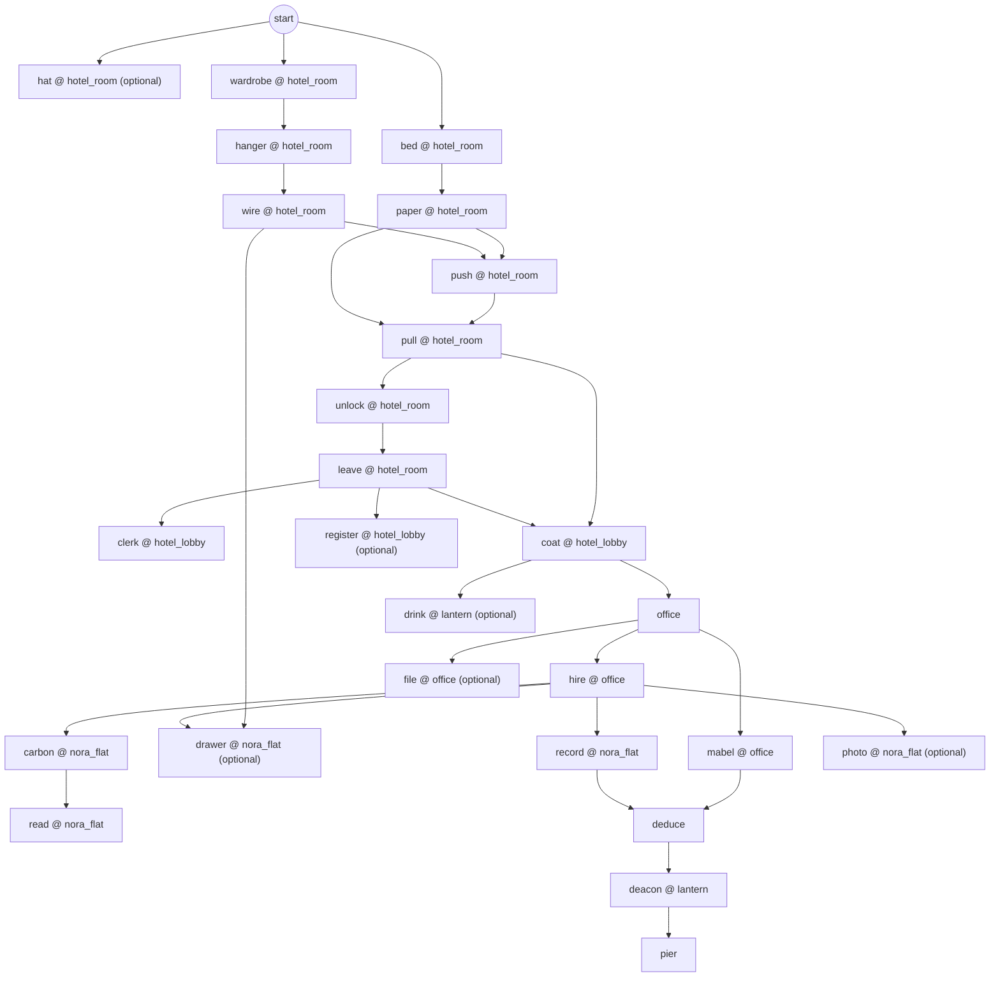
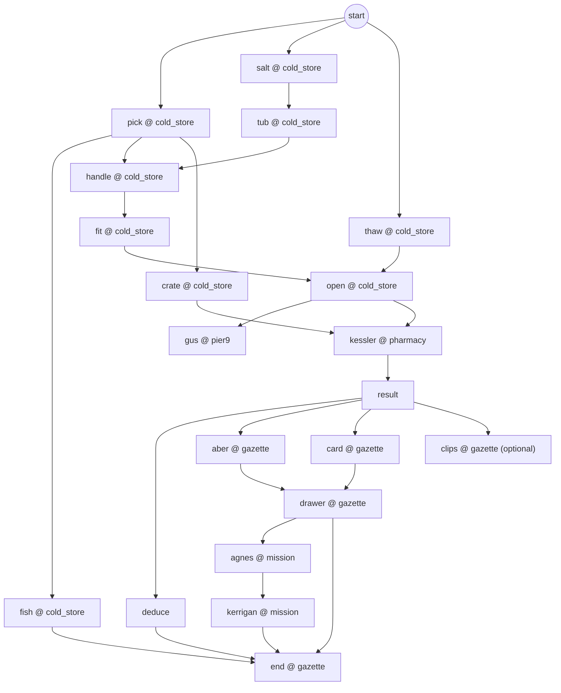
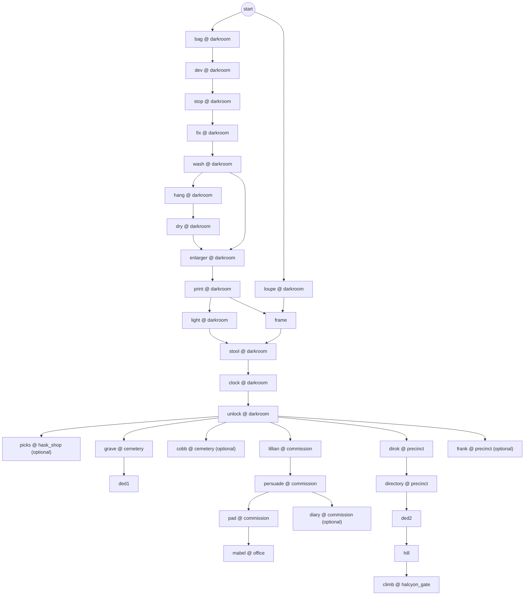
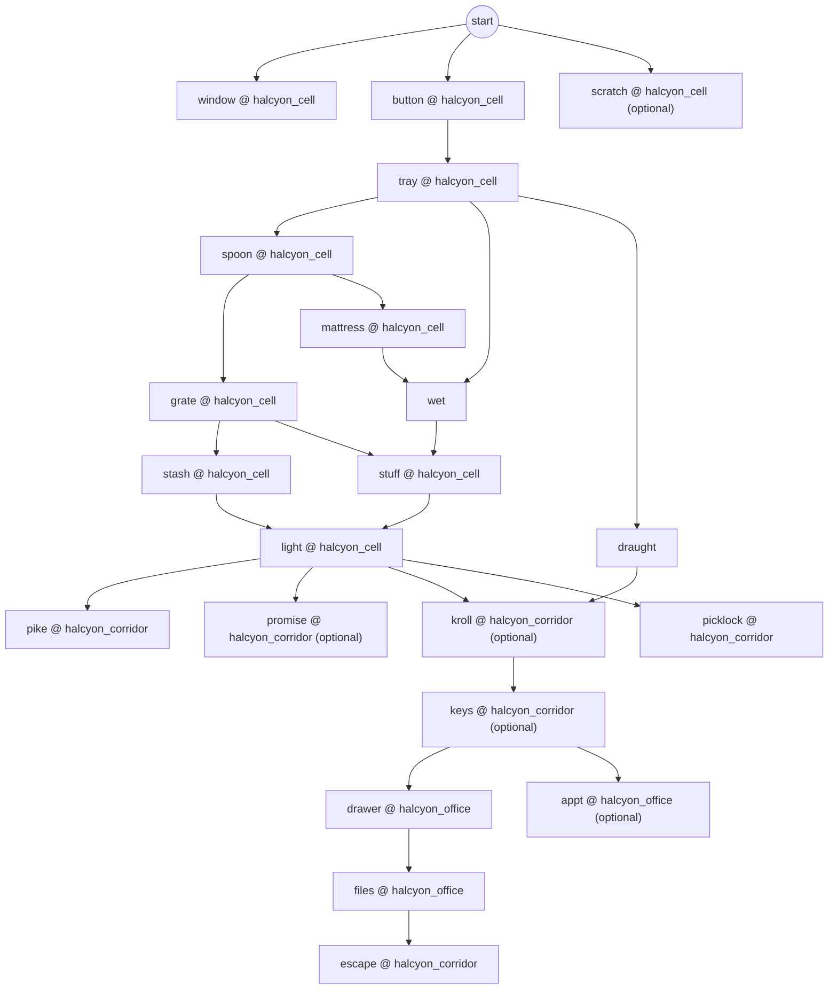
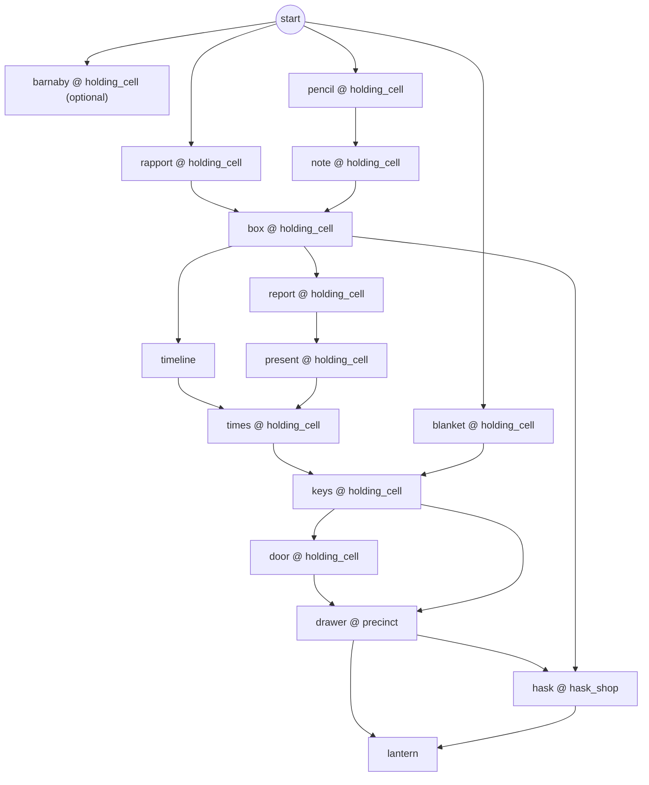
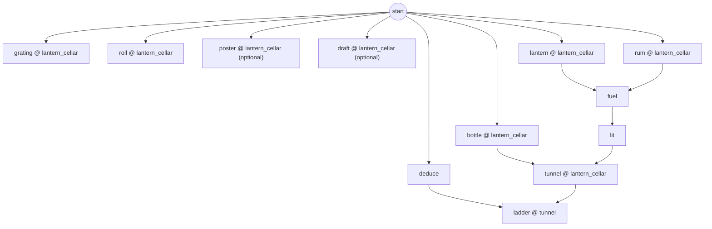
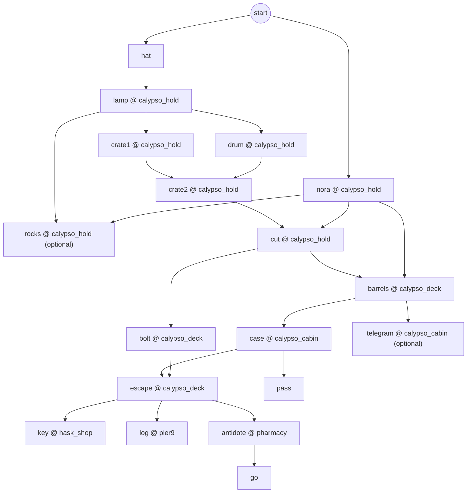
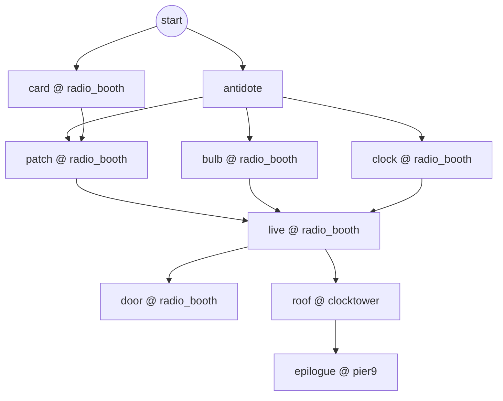

# Night Latch — Puzzle dependency graph

Generated by `npm run validate` from `tools/walkthrough.ts`, the machine-checked critical path. An arrow A → B means that completing step A is what made a precondition of step B true, measured in a headless playthrough. Steps without arrows are available from the chapter start. The automated playtests execute these steps in randomized valid orders (see `docs/TEST_REPORT.md`).

## Chapter 1: Room Nine

| step | where | needs | done when | actions |
|---|---|---|---|---|
| c1.hat | hotel_room | `true` | `c1_hat_taken` | use hat |
| c1.bed | hotel_room | `true` | `c1_newspaper_found` | use bed |
| c1.wardrobe | hotel_room | `true` | `c1_wardrobe_open` | use wardrobe |
| c1.hanger | hotel_room | `c1_wardrobe_open` | `c1_hanger_taken` | use hanger |
| c1.wire | hotel_room | `has:hanger` | `has:wire | c1_key_pushed` | item hanger → radiator |
| c1.paper | hotel_room | `has:newspaper & !c1_key_got` | `c1_paper_door | c1_key_got` | item newspaper → gap |
| c1.push | hotel_room | `c1_paper_door & has:wire` | `c1_key_pushed` | item wire → keyhole |
| c1.pull | hotel_room | `c1_key_pushed & c1_paper_door` | `c1_key_got` | use newspaper_door |
| c1.unlock | hotel_room | `has:key9` | `c1_room9_open` | item key9 → door |
| c1.leave | hotel_room | `c1_room9_open` | `visited:hotel_lobby` | use door |
| c1.clerk | hotel_lobby | `visited:hotel_lobby` | `clue:two_men` | use pettibone (says: who, coat, bye) |
| c1.coat | hotel_lobby | `has:key9 & visited:hotel_lobby` | `has:lighter` | item key9 → pettibone |
| c1.register | hotel_lobby | `visited:hotel_lobby` | `clue:register` | look register |
| c1.office | — | `has:lighter` | `visited:office` | go office |
| c1.mabel | office | `visited:office` | `clue:ask_piano` | use mabel (says: told, nora, calls, bye) |
| c1.hire | office | `visited:office` | `c1_hired` | use evelyn (says: what, about, reach, take) |
| c1.file | office | `visited:office` | `clue:meridian_file` | use filing_cabinet |
| c1.drawer | nora_flat | `has:wire & c1_hired` | `clue:nora_list` | item wire → desk |
| c1.carbon | nora_flat | `c1_hired` | `c1_carbon_taken` | use wastebasket |
| c1.read | nora_flat | `has:carbon` | `clue:nora_letter` | item carbon → window |
| c1.record | nora_flat | `c1_hired` | `clue:lamplighter_record` | use gramophone |
| c1.photo | nora_flat | `c1_hired` | `clue:family_photo` | look photo |
| c1.deduce | — | `clue:ask_piano & clue:lamplighter_record` | `ded:piano_is_deacon` | deduce ask_piano + lamplighter_record |
| c1.drink | lantern | `map:lantern & has:lighter` | `c1_drink_offered` | use sal (says: drink, bye) |
| c1.deacon | lantern | `ded:piano_is_deacon` | `clue:on_ice` | use deacon (says: lullaby, bye) |
| c1.pier | — | `clue:on_ice` | `c1_end` | go pier9 |

## Chapter 2: On Ice

| step | where | needs | done when | actions |
|---|---|---|---|---|
| c2.pick | cold_store | `true` | `c2_pick_taken` | use workbench |
| c2.fish | cold_store | `c2_pick_taken` | `c2_fish_cut` | item ice_pick → fish_b3 |
| c2.salt | cold_store | `!c2_salted` | `has:rock_salt | c2_salted` | use salt |
| c2.tub | cold_store | `has:rock_salt` | `c2_salted` | item rock_salt → tub |
| c2.handle | cold_store | `c2_salted & c2_pick_taken` | `c2_handle_taken` | item ice_pick → tub |
| c2.fit | cold_store | `has:release_handle` | `c2_handle_fitted` | item release_handle → spindle |
| c2.thaw | cold_store | `true` | `c2_thawed` | item lighter → spindle |
| c2.crate | cold_store | `c2_pick_taken` | `c2_crate_open` | item ice_pick → crates |
| c2.open | cold_store | `c2_handle_fitted & c2_thawed` | `c2_door_open` | use spindle |
| c2.gus | pier9 | `c2_door_open` | `clue:gus_hammering & clue:gus_saw` | use gus (says: saw, meridian, detective, bye) |
| c2.kessler | pharmacy | `has:vial & map:pharmacy & c2_door_open & !clue:lethe_identified` | `c2_vial_testing | clue:lethe_identified` | use kessler (says: vial, bye) |
| c2.result | — | `c2_vial_testing` | `clue:lethe_identified` | go pier9; go pharmacy; use kessler (says: result, who, bye) |
| c2.deduce | — | `clue:lethe_identified & clue:lost_days` | `ded:i_was_drugged` | deduce lethe_identified + lost_days |
| c2.aber | gazette | `map:gazette` | `c2_desk_ok` | use abernathy (says: pike, desk, meridian, bye) |
| c2.card | gazette | `map:gazette` | `has:press_card` | use press_card |
| c2.drawer | gazette | `c2_desk_ok & c2_saw_417` | `cu_pike_lock` | use pike_drawer |
| c2.clips | gazette | `map:gazette` | `clue:clipping_suspension` | use clippings |
| c2.agnes | mission | `map:mission` | `c2_kerrigan_ok` | use agnes (says: forgotten, kerrigan, bye) |
| c2.kerrigan | mission | `c2_kerrigan_ok` | `clue:kerrigan` | use kerrigan (says: meridian, face, bye) |
| c2.end | gazette | `has:pike_camera & ded:i_was_drugged & has:minutes1 & clue:kerrigan` | `c2_end` | use darkroom_door |

## Chapter 3: Safelight

| step | where | needs | done when | actions |
|---|---|---|---|---|
| c3.bag | darkroom | `true` | `c3_film_in_tank` | item pike_camera → changing_bag |
| c3.dev | darkroom | `c3_film_in_tank` | `c3_dev` | use bottle_dev |
| c3.stop | darkroom | `c3_dev` | `c3_stop` | use bottle_stop |
| c3.fix | darkroom | `c3_stop` | `c3_fix` | use bottle_fix |
| c3.wash | darkroom | `c3_fix` | `c3_washed` | use sink |
| c3.hang | darkroom | `has:negatives & !c3_neg_hung` | `c3_neg_hung` | item negatives → drying_line |
| c3.dry | darkroom | `c3_neg_hung` | `c3_neg_dry` | use drying_line |
| c3.enlarger | darkroom | `c3_neg_dry & has:negatives` | `c3_neg_in_enlarger` | item negatives → enlarger |
| c3.print | darkroom | `c3_neg_in_enlarger` | `has:contact_sheet` | use paper_box |
| c3.light | darkroom | `has:contact_sheet` | `c3_white` | use switch |
| c3.stool | darkroom | `c3_white & clue:photo_clock` | `c3_stool_moved` | use stool |
| c3.clock | darkroom | `c3_stool_moved` | `c3_clock_open` | use clock |
| c3.unlock | darkroom | `has:padlock_key` | `c3_unlocked` | item padlock_key → padlock |
| c3.picks | hask_shop | `has:wire & c3_unlocked` | `has:lockpicks` | item wire → picks_drawer |
| c3.grave | cemetery | `c3_unlocked` | `clue:flowers & clue:only_child` | look marsh_grave; look card |
| c3.cobb | cemetery | `c3_unlocked` | `clue:scarf` | use cobb (says: visitors, bye) |
| c3.lillian | commission | `c3_unlocked` | `c3_lillian_asked` | use lillian (says: session, who, pad, favor, bye) |
| c3.persuade | commission | `c3_lillian_asked & !c3_pruett_away & !c3_pad_taken` | `c3_pruett_away | c3_pad_taken` | use lillian (says: proof) |
| c3.pad | commission | `c3_pruett_away & !c3_pad_taken` | `c3_pad_taken` | use out_tray |
| c3.diary | commission | `c3_pruett_away & !c3_pad_taken` | `clue:gala` | use diary |
| c3.mabel | office | `has:steno_pad` | `clue:steno_transcript` | item steno_pad → mabel |
| c3.dirok | precinct | `c3_unlocked` | `c3_directory_ok` | use pruitt (says: vandermeer, directory, bye) |
| c3.directory | precinct | `c3_directory_ok` | `clue:phone_halcyon` | use directory |
| c3.frank | precinct | `c3_unlocked` | `clue:rest_home` | use delaney; look coat_rack (says: fortynine, lighter, bye) |
| c3.ded1 | — | `clue:evelyn_claim & clue:only_child` | `ded:evelyn_impostor` | deduce evelyn_claim + only_child |
| c3.ded2 | — | `clue:phone_halcyon & clue:evelyn_watch` | `ded:evelyn_nurse` | deduce phone_halcyon + evelyn_watch |
| c3.loupe | darkroom | `has:wire` | `has:loupe` | item wire → cabinet |
| c3.frame | — | `has:loupe & has:contact_sheet` | `clue:photo_clock` | combine loupe + contact_sheet |
| c3.hill | — | `map:halcyon` | `visited:halcyon_gate` | go halcyon_gate |
| c3.climb | halcyon_gate | `visited:halcyon_gate` | `c3_end` | use ashcan |

## Chapter 4: Room Eight

| step | where | needs | done when | actions |
|---|---|---|---|---|
| c4.window | halcyon_cell | `true` | `clue:fire_procedure` | look window |
| c4.button | halcyon_cell | `true` | `c4_tray` | use button |
| c4.tray | halcyon_cell | `c4_tray` | `c4_tray_taken` | use hatch |
| c4.spoon | halcyon_cell | `has:spoon` | `has:flat_spoon` | item spoon → concrete |
| c4.grate | halcyon_cell | `has:flat_spoon` | `c4_grate_open` | item flat_spoon → vent |
| c4.stash | halcyon_cell | `c4_grate_open` | `c4_stash_taken` | use vent |
| c4.mattress | halcyon_cell | `has:flat_spoon` | `c4_mattress_torn` | item flat_spoon → mattress |
| c4.wet | — | `has:straw & has:cup` | `has:damp_straw | c4_straw_in` | combine cup + straw |
| c4.stuff | halcyon_cell | `has:damp_straw & c4_grate_open` | `c4_straw_in` | item damp_straw → vent |
| c4.light | halcyon_cell | `c4_straw_in & has:matches` | `c4_door_open` | item matches → vent |
| c4.scratch | halcyon_cell | `true` | `clue:been_here` | look scratches |
| c4.pike | halcyon_corridor | `c4_door_open & has:press_card` | `clue:pike_recalls` | item press_card → pike |
| c4.promise | halcyon_corridor | `c4_door_open` | `c4_promise_pike` | use pike (says: name, come, bye) |
| c4.draught | — | `has:cup & has:pills` | `has:sleep_draught` | combine cup + pills |
| c4.kroll | halcyon_corridor | `has:sleep_draught & c4_door_open & !c4_office_open` | `has:ring_keys` | item sleep_draught → kroll |
| c4.keys | halcyon_corridor | `has:ring_keys & !c4_office_open` | `c4_office_open` | item ring_keys → exit_office |
| c4.picklock | halcyon_corridor | `c4_door_open` | `c4_office_open` | item lockpicks → exit_office |
| c4.drawer | halcyon_office | `c4_office_open` | `c4_cabinet_key` | use drawer |
| c4.files | halcyon_office | `c4_cabinet_key` | `has:halcyon_files` | use cabinet_1949 |
| c4.appt | halcyon_office | `c4_office_open` | `clue:calypso_schedule` | use appt_book |
| c4.escape | halcyon_corridor | `has:halcyon_files` | `c4_end` | use laundry_cart |

## Chapter 5: Holding

| step | where | needs | done when | actions |
|---|---|---|---|---|
| c5.barnaby | holding_cell | `true` | `clue:calypso_rocks` | use barnaby (says: calypso, lieutenant, bye) |
| c5.rapport | holding_cell | `true` | `c5_rapport` | use pruitt (says: vandermeer, bye) |
| c5.pencil | holding_cell | `!c5_pencil` | `c5_pencil` | use bunk |
| c5.note | holding_cell | `has:pencil & has:cigarette_paper` | `has:pruitt_note` | combine pencil + cigarette_paper |
| c5.box | holding_cell | `c5_rapport & has:pruitt_note` | `c5_box` | item pruitt_note → bars |
| c5.report | holding_cell | `c5_box` | `c5_report_read` | use pruitt (says: report, bye) |
| c5.present | holding_cell | `c5_report_read` | `clue:hatch_locked` | use pruitt (says: present) |
| c5.timeline | — | `c5_box` | `tl_meridian_night` | timeline |
| c5.times | holding_cell | `tl_meridian_night & clue:hatch_locked` | `c5_keys_moved` | use pruitt (says: times) |
| c5.blanket | holding_cell | `true` | `c5_blanket` | use blanket |
| c5.keys | holding_cell | `c5_keys_moved & has:blanket` | `has:cell_keys` | item blanket → keys_near |
| c5.door | holding_cell | `has:cell_keys` | `c5_cell_open` | item cell_keys → cell_door |
| c5.drawer | precinct | `c5_cell_open & has:cell_keys` | `c5_drawer` | item cell_keys → desk_drawer |
| c5.hask | hask_shop | `c5_drawer & has:padlock` | `clue:padlock_order` | use hask (says: meridian_lock, bye) |
| c5.lantern | — | `c5_drawer & clue:padlock_order` | `c5_end` | go lantern |

## Chapter 6: The Lantern Cellar

| step | where | needs | done when | actions |
|---|---|---|---|---|
| c6.grating | lantern_cellar | `true` | `clue:overheard` | use grating |
| c6.roll | lantern_cellar | `true` | `c6_roll_opened` | use roll_box |
| c6.poster | lantern_cellar | `true` | `clue:est_1924` | look poster |
| c6.draft | lantern_cellar | `!c6_rack_open` | `clue:draft` | item lighter → rack |
| c6.bottle | lantern_cellar | `true` | `c6_rack_open` | use bottle_1924 |
| c6.lantern | lantern_cellar | `true` | `c6_lantern_taken` | use lantern_hook |
| c6.rum | lantern_cellar | `true` | `c6_rum_taken` | use rum |
| c6.fuel | — | `has:lantern & has:rum` | `has:lantern_fueled | has:lantern_lit` | combine lantern + rum |
| c6.lit | — | `has:lantern_fueled` | `has:lantern_lit` | combine lantern_fueled + lighter |
| c6.deduce | — | `clue:volunteer & (clue:flowers | clue:scarf)` | `ded:nora_at_mission` | deduce volunteer + flowers |
| c6.tunnel | lantern_cellar | `c6_rack_open & has:lantern_lit` | `visited:tunnel` | use exit_tunnel |
| c6.ladder | tunnel | `ded:nora_at_mission & visited:tunnel` | `c6_end` | use ladder (says: eighth, plan, why, truth, soup, page3, go) |

## Chapter 7: Below the Waterline

| step | where | needs | done when | actions |
|---|---|---|---|---|
| c7.hat | — | `has:hat` | `c7_matches` | examine hat |
| c7.lamp | calypso_hold | `has:hat_matches` | `c7_lit` | item hat_matches → lantern |
| c7.nora | calypso_hold | `true` | `c7_contact & has:walter_knife` | use pipe (says: call, things, knife, plan) |
| c7.crate1 | calypso_hold | `c7_lit` | `c7_crate1` | use crate1 |
| c7.drum | calypso_hold | `c7_lit` | `c7_drum` | use drum |
| c7.crate2 | calypso_hold | `c7_crate1 & c7_drum` | `c7_crate2` | use crate2 |
| c7.rocks | calypso_hold | `c7_lit & has:walter_knife & !c7_out` | `c7_rocks` | item walter_knife → crates_heavy |
| c7.cut | calypso_hold | `c7_crate2 & has:walter_knife` | `c7_out` | item walter_knife → net |
| c7.bolt | calypso_deck | `c7_out` | `c7_nora_free` | use bolt |
| c7.barrels | calypso_deck | `c7_out & has:walter_knife` | `c7_barrels` | item walter_knife → rope |
| c7.case | calypso_cabin | `c7_barrels` | `c7_case_open` | look briefcase; use briefcase |
| c7.telegram | calypso_cabin | `c7_barrels` | `clue:telegram` | look telegram |
| c7.escape | calypso_deck | `c7_case_open & c7_nora_free` | `c7_escaped` | use gangway |
| c7.key | hask_shop | `c7_planned` | `has:booth_key` | use hask (says: key, bye) |
| c7.pass | — | `has:blank_form & has:rubber_stamp` | `has:press_pass` | combine blank_form + rubber_stamp |
| c7.log | pier9 | `c7_planned` | `has:gus_log` | use gus (says: log7, bye) |
| c7.antidote | pharmacy | `c7_planned` | `has:antidote` | use kessler (says: antidote7, bye) |
| c7.go | — | `map:cityhall` | `c7_end` | go radio_booth |

## Chapter 8: On Air

| step | where | needs | done when | actions |
|---|---|---|---|---|
| c8.antidote | — | `has:antidote` | `c8_clear` | examine antidote |
| c8.card | radio_booth | `true` | `clue:patch_card` | look card |
| c8.patch | radio_booth | `c8_clear & clue:patch_card` | `cu_patch_booth` | use patch_bay |
| c8.bulb | radio_booth | `c8_clear` | `c8_bulb` | use onair_lamp |
| c8.clock | radio_booth | `c8_clear` | `c8_nine` | use clock |
| c8.live | radio_booth | `cu_patch_booth & c8_bulb & c8_nine` | `c8_confessed` | item booth_key → transmitter; use mic (says: show1, show2, show3, show4, frank, early, padlock, walter) |
| c8.door | radio_booth | `c8_confessed` | `visited:clocktower` | use door |
| c8.roof | clocktower | `c8_confessed` | `c8_surrender` | use delaney (says: show, truth, after, knife, now, go) |
| c8.epilogue | pier9 | `c8_dawn` | `game_complete` | use nora (says: truth, after, knife, now, go) |

